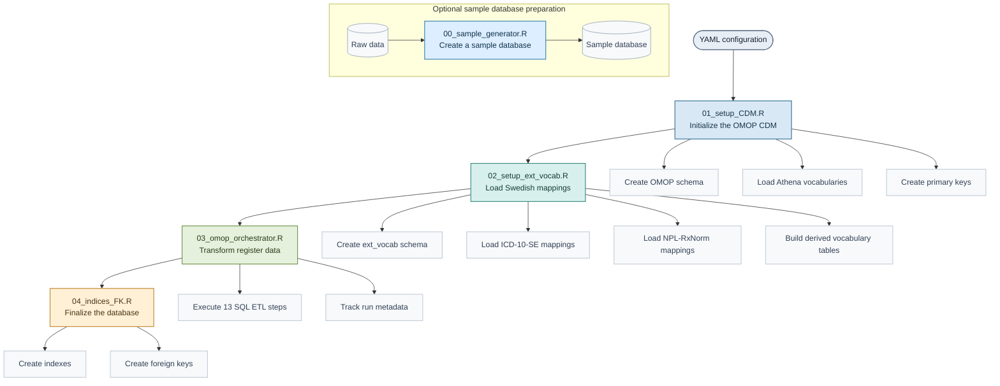

# Overview

This repository contains the R and SQL pipeline that transforms Swedish register data into OMOP CDM tables in PostgreSQL. This document describes the pipeline; field-level source-to-target mappings, transformation rules, and review notes are maintained in the [SWEEP ETL design workbook](SWEEP_ETL_specification.xlsx), while the SQL files define executable behavior.

Mapping uses the OMOP CDM version and vocabulary release available at the time of execution. The `cdm_source.vocabulary_version` value comes from the loaded Athena `VOCABULARY` table, and the release template calls for recording Athena and external vocabulary versions. However, `metadata.etl_runs` does not currently capture vocabulary versions or source-file checksums, so external vocabulary provenance is not yet verifiable per ETL run.

The pipeline consists of four required stages and an optional sample-data preparation step:

0\. **Optional sample generator**

1\. **CDM setup**

2\. **External vocabulary setup**

3\. **ETL execution**

4\. **Post-processing (indexes and foreign keys)**

------------------------------------------------------------------------

# Mapping Documentation

## Documentation sources and ownership

This documentation uses three complementary sources:

- **Executable source of truth:** SQL files under `sql/omop/` and `sql/external_vocabularies/`. The SQL determines the actual transformation applied to the database.
- **ETL mapping design:** [`docs/SWEEP_ETL_specification.xlsx`](SWEEP_ETL_specification.xlsx). This is the detailed, reviewable register of destination fields, source fields, transformation rules, vocabulary mappings, and open questions.
- **Published explanation:** this document. It explains the pipeline and summarizes the mapping decisions so that the logic can be read without opening the workbook or SQL files.

Transformation logic is maintained in SQL, with corresponding field-level mappings in the workbook and decision summaries in this document. SQL is authoritative if the workbook or narrative documentation differs from the executable transformation.

## ETL mapping design format

The workbook organizes mappings into sheets by target table and records one or more input data rows per destination field. Its columns are:

| Column | Purpose |
|---|---|
| Destination field | OMOP destination column |
| Source field(s) | Register field, intermediate field, or upstream OMOP field |
| Logic | Join, filter, calculation, concept assignment, or derivation |
| Comment | Rationale, domain interpretation, or data-quality rule |
| Notes | Open question, limitation, requested data improvement, or follow-up |

These columns form the workbook's current field-level mapping format.

Example row:

| Destination field | Source field(s) | Logic | Comment | Notes |
|---|---|---|---|---|
| `drug_concept_id` | `lmed$varunr` and `ext_vocab.varunr_to_concept_final` | Left join the source drug code to the external mapping and retain only standard Drug concepts; use `0` when no mapping is found | VARUNR to RxNorm/RxNorm Extension. Implemented in `sql/omop/05_lmed_to_drug_exposure.sql`. | Mapping coverage and unmapped-code handling remain under review. |

For drug exposure, VARUNR is the concept-mapping key, while the current SQL stores ATC in `drug_source_value`. The workbook's `drug_concept_id` row documents the mapping key; the source-value choice is documented separately in [Vocabulary and Concept Mappings](vocabulary.md).

## Current mapping inventory

The workbook covers the following transformation groups:

| Mapping group | Source tables | OMOP outputs | Main logic file(s) |
|---|---|---|---|
| Person and cohort eligibility | `grunduppgifter`, `lmed`, `migrationer`, `dors` | `person` | `sql/omop/01_grunduppgifter_to_person.sql` |
| Death | `grunduppgifter`, `dors` | `death` | `sql/omop/02_grunduppgifter_and_dors_to_death.sql` |
| Observation periods | `tpr`, `migrationer`, `dors` | `observation_period` | `sql/omop/03_tpr_and_dors_to_observation_period.sql` |
| Visits | `par_ov`, `par_sv` | `visit_occurrence` | `sql/omop/04_par_to_visit_occurrence.sql` |
| Drug exposure | `lmed` | `drug_exposure` | `sql/omop/05_lmed_to_drug_exposure.sql` |
| Demographic and LISA observations | `grunduppgifter`, `lisa_2005`-`lisa_2023` | `observation` | `sql/omop/07_grunduppgifter_lisa_to_observation.sql` |
| Inpatient clinical events | `par_sv` | `condition_occurrence`, `measurement`, `procedure_occurrence`, `observation` | `sql/omop/06a_parsv_to_condition_measurement_procedure_observation.sql` |
| Outpatient clinical events | `par_ov` | `condition_occurrence`, `measurement`, `procedure_occurrence`, `observation` | `sql/omop/06b_parov_to_condition_measurement_procedure_observation.sql` |
| Death-related clinical events | `dors` | `condition_occurrence`, `measurement`, `procedure_occurrence`, `observation` | `sql/omop/06c_dors_to_condition_measurement_procedure_observation.sql` |
| Cancer clinical events | `can` | `condition_occurrence`, `measurement`, `procedure_occurrence`, `observation` | `sql/omop/06d_can_to_condition_measurement_procedure_observation.sql` |
| Drug eras | `drug_exposure` | `drug_era` | `sql/omop/08_drug_era.sql` |
| Condition eras | `condition_occurrence` | `condition_era` | `sql/omop/09_condition_era.sql` |
| CDM metadata | ETL configuration and run metadata | `cdm_source` | `sql/omop/10_metadata.sql` |

## Workbook coverage

The current workbook contains these sheets:

| Workbook sheet | OMOP fields covered | Main review focus |
|---|---|---|
| `person` | `person_id`, demographic fields, source values | SWEEP eligibility, data-quality and plausibility constraints, sex concept mapping |
| `death` | death date, death type, cause fields | Duplicate death records, incomplete dates, data lock point, cause-of-death mapping |
| `observation_period` | period identifier, person, start/end dates, period type | Migration-event cleaning, residency at the anchor date, multiple periods, merging of overlapping and adjacent periods |
| `visit_occurrence` | visit identifier, person, visit concept, dates, type | Inpatient/outpatient source integration and overlapping visits |
| `drug_exposure` | exposure identifier, person, drug concepts, dates, type, quantity | Product exclusions, VARUNR mapping, exposure end-date rules |
| `condition_occurrence` | condition identifier, person, concepts, dates, source values, visit | ICD-10 and cancer source mapping, domain routing, duplicate clinical events |
| `observation` | person, observation concept/source, value, date | Country of birth, county, civil status, education level, disposable income, and routed non-condition clinical events |
| `measurement` | measurement identifier, person, concept, date, type, source value | ICD-10-SE codes from PAR and the cause-of-death register routed to the Measurement domain via ICD-10-WHO → SNOMED CT; type concept per source register |
| `procedure_occurrence` | procedure identifier, person, concept, date, type, source value | ICD-10-SE codes from PAR and the cause-of-death register routed to the Procedure domain via ICD-10-WHO → SNOMED CT; type concept per source register |

The `measurement` and `procedure_occurrence` sheets document records from PAR (`par_sv`, `par_ov`) and the cause-of-death register (`dors`). Cancer register records that `06d_can_to_condition_measurement_procedure_observation.sql` routes to these tables are not yet documented in the workbook.

## Related documentation

The repository's documentation set is organized by topic:

- `docs/Documentation_Mapping.md` — overview, architecture, execution order, and mapping documentation;
- `docs/purpose.md` — cohort purpose, target population, data sources, observation window, and intended use;
- `docs/transformation.md` — transformation logic, dependencies, exclusions, date handling, and domain routing;
- `docs/vocabulary.md` — Athena, ICD-10, SNOMED, VARUNR, RxNorm, and custom mapping assets;
- `docs/data_quality.md` — validation rules, attrition checks, known defects, and unresolved mapping questions;
- `docs/RELEASES.md` — version and release history.

The workbook contains field-level mappings. The Markdown pages summarize decisions, assumptions, and relationships between transformations.

This document summarizes the mapping design and links to the relevant workbook and SQL sources rather than reproducing every workbook row.

## Documented decision areas

The mapping documentation records decisions that affect interpretation or reproducibility, including:

- cohort inclusion and exclusion criteria;
- incomplete-date imputation and observation-window censoring;
- source-to-OMOP vocabulary translation and unmapped-code handling;
- routing records between `condition_occurrence`, `measurement`, `procedure_occurrence`, and `observation`;
- duplicate handling and generated identifiers;
- dependencies on external vocabulary tables;
- known limitations and items listed as `to fix` in the SQL comments.

------------------------------------------------------------------------

# Architecture

The pipeline can be run on a sample dataset (for testing/workshop) or the full production data.

## Database Architecture

**PostgreSQL Instances:**
- **Production** (port 5432): `swedish_registry_prod_2026v1` (or `swedish_registry_YYYYvX` for year-based versioning)
- **Test/Development** (port 5433): `swedish_registry_test` (test), `swedish_registry_smoke` (CI)

**Database Schemas:**
- `raw_YYYY` - Source Swedish register data for the year covered by the source data
- `omopxy` - OMOP CDM vx.ý output tables
- `ext_vocab_YYYY_MM` - External vocabulary mappings for year YYYY and month MM (~5GB, includes ICD10-SE, NPL-RxNorm)
- `etl_common` - Shared ETL functions
- `metadata` - ETL run tracking and versioning

## Pipeline Flow



------------------------------------------------------------------------

# Configuration

All scripts use YAML configuration files:

- **`config/settings.local.yaml`** - Local configuration
- **`config/settings.test.yaml`** - Test configuration (test/dev database)
- **`config/settings.smoke.yaml`** - CI/smoke test configuration (smaller sample)
- **`config/settings.prod_YYYY_MM.yaml`** - Production configuration (full data)

Key configuration sections:

```yaml
project:
  name: omop_etl
  log_dir: logs

source_db:
  host: "127.0.0.1"
  port: 5433
  dbname: "swedish_registry_test"
  user_env: "DB_USER"
  # Optional: read password from an environment variable when needed by psql.
  # password_env: "DB_PASSWORD"

schemas:
  INPUT_SCHEMA: "raw_2024"
  OUTPUT_SCHEMA: "omop54"
  metadata_schema: "metadata"
  cdm_schema: "omop54"
  cdm_version: "5.4"
  ext_vocab_schema: "ext_vocab_2026_02"

sampling:
  input_schema: "raw_2024"
  output_schema: "raw_sample"
  # Optional: per-database password env vars for cross-db sampling/FDW.
  # Defaults to source_db.password_env when omitted.
  # input_password_env: "DB_PASSWORD"
  # output_password_env: "DB_PASSWORD"
  # Optional. Defaults to source_db.dbname when omitted.
  # Set these only when sampling input/output are in different databases.
  # input_dbname: swedish_registry_test
  # output_dbname: swedish_registry_test
  # Optional cross-database FDW bootstrap (executed in output DB).
  # fdw_auto_setup: true
  # fdw_server_name: sampling_input_db_server
  # fdw_local_schema: raw_2024_fdw

vocabularies:
  dir_path: "D:/Athena_Vocabularies"
  external:
    icd10se_codes_tsv_path: "D:/Vocabularies/.../icd-10-se.tsv"
    lisa_tpr_map_csv_path: "vocabularies/external/tpr_lisa_external_vocab.csv"
    nplid_to_rxnorm_csv_path: "D:/Vocabularies/nplid_to_drug_exposure.csv"
```

------------------------------------------------------------------------

# Pipeline components

## Sample Generator (`R/orchestrators/00_sample_generator.R`)

**Purpose:** Creates a sample dataset for testing and workshops.

**Execution:**
- Runs `sql/sampling/sample_generator.sql`
- Generates sample of 500,000-5,000,000 unique LopNrs randomly selected from grunduppgifter
- Filters all source tables for these LopNrs

**Configuration:**
```yaml
run:
  sample_size: 500000  # Adjustable
```

## CDM Setup (`R/orchestrators/01_setup_CDM.R`)

**Purpose:** Initializes the configured OMOP CDM schema and loads the standard vocabularies selected for the ETL release.

**Key Steps:**

1. **Create OMOP schema:**
   - Generates OMOP CDM DDL using `CommonDataModel` package
   - Translates to PostgreSQL dialect via `SqlRender`
   - Executes via DBI

2. **Load Athena vocabularies:**
   - Loads CSV files from `D:/Athena_Vocabularies` using `psql` bulk copy
   - Tables: CONCEPT, VOCABULARY, DOMAIN, CONCEPT_CLASS, CONCEPT_RELATIONSHIP, etc.
   - Uses optimized `\copy` command for performance

3. **Create primary keys:**
   ```r
   CommonDataModel::createPrimaryKeys(cdmVersion = "5.4")
   ```

**SQL Scripts:**
- Uses DDL from `sql/5.4/postgresql/OMOPCDM_postgresql_5.4_ddl.sql`
- Primary keys from `OMOPCDM_postgresql_5.4_primary_keys.sql`

## External Vocabulary Setup (`R/orchestrators/02_setup_ext_vocab.R`)

**Purpose:** Creates and loads custom Swedish vocabulary mappings not available in Athena.

**Key Steps:**

1. **Create ext_vocab schema and tables:**
   - Runs `sql/external_vocabularies/ext_vocab_1a_varunr_rxnorm.sql`

2. **Load NPLID → RxNorm mapping:**
   ```r
   df <- read.csv("nplid_to_drug_exposure.csv", sep=";")
   dbWriteTable(con, Id(schema = "ext_vocab", table = "nplid_rxnorm"), df)
   ```

3. **Create VARUNR → RxNorm mapping:**
   - Runs `ext_vocab_1_varunr_rxnorm.sql`
   - Joins VARUNR codes with NPLID mappings

4. **Create ICD10-SE → ICD10-WHO mappings:**
   - Loads Socialstyrelsen's ICD-10-SE code list (`icd-10-se.tsv`) into `icd10se_codes`
   - Runs `ext_vocab_2_icd10se_icd10.sql`, which maps each ICD-10-SE code to its longest prefix that is a valid Athena ICD10 code
   
5. **Create additional mappings:**
   - `ext_vocab_3_icd10se_who_snomed.sql` - ICD10-SE → SNOMED
   - `ext_vocab_4_icd10who_snomed.sql` - ICD10-WHO → SNOMED

6. **Load the TPR/LISA mapping:**
   - Reads `vocabularies/external/tpr_lisa_external_vocab.csv` and stops if a description + code pair appears twice
   - Runs `ext_vocab_5_lisa_tpr_map.sql` and loads the file into `lisa_tpr_map`

**External Vocabulary Files (~5GB):**
- Swedish NPL drug codes to RxNorm
- ICD10-SE to ICD10-WHO and SNOMED mappings

## ETL Orchestrator (`R/orchestrators/03_omop_orchestrator.R`)

**Purpose:** Executes SQL transformation scripts to convert Swedish register data to OMOP CDM.

**Key Features:**
- **Automatic versioning** from git tags (e.g., `omop-etl-v1.1.0`) or commit hash (`dev-a1b2c3d`)
- **ETL run tracking** in `metadata.etl_runs` table
- **User tracking** captures system username
- **Error handling** with proper status tracking (running/completed/failed)
- **Row count logging** for data quality verification

**Configuration:**
```r
input_schema  <- get_setting_or_default(settings, c("schemas", "INPUT_SCHEMA"), "raw")
output_schema <- get_setting_or_default(settings, c("schemas", "OUTPUT_SCHEMA"), "omop54")
```

**ETL Pipeline Steps (14 SQL files):**

```r
steps <- list(
  list(file = "00_create_functions.sql"),
  list(file = "01_grunduppgifter_to_person.sql",
       rows_input = c("grunduppgifter", "dors", "lmed", "migrationer"),
       rows_output = "person"),
  list(file = "02_grunduppgifter_and_dors_to_death.sql",
       rows_input = c("grunduppgifter", "dors"),
       rows_output = "death"),
    list(file = "03_tpr_and_dors_to_observation_period.sql",
      rows_input = c("grunduppgifter", "migrationer", "dors"),
      rows_output = "observation_period"),
  list(file = "04_par_to_visit_occurrence.sql",
       rows_input = c("par_ov", "par_sv"),
       rows_output = "visit_occurrence"),
    list(file = "05_lmed_to_drug_exposure.sql",
      rows_input = "lmed",
      rows_output = "drug_exposure"),
  list(file = "06a_parsv_to_condition.sql",
       rows_input = "par_sv",
       rows_output = c("condition_occurrence", "observation", "measurement", "procedure_occurrence")),
  list(file = "06b_parov_to_condition.sql",
       rows_input = "par_ov",
       rows_output = c("condition_occurrence", "observation", "measurement", "procedure_occurrence")),
  list(file = "06c_dors_to_condition.sql",
       rows_input = "dors",
       rows_output = c("condition_occurrence", "observation", "measurement", "procedure_occurrence")),
    list(file = "06a_parsv_to_condition_measurement_procedure_observation.sql",
       rows_input = "can",
       rows_output = c("condition_occurrence", "observation", "measurement", "procedure_occurrence")),
    list(file = "06b_parov_to_condition_measurement_procedure_observation.sql",
  list(file = "08_condition_era.sql"),
  list(file = "09_metadata.sql")
    list(file = "06c_dors_to_condition_measurement_procedure_observation.sql",
```

    list(file = "06d_can_to_condition_measurement_procedure_observation.sql",
- `grunduppgifter` - Basic person information
- `dors` - Death records
- `lmed` - Medication dispensing (drugs)
    list(file = "08_drug_era.sql"),
    list(file = "09_condition_era.sql"),
    list(file = "10_metadata.sql")
- `can` - Cancer register

**OMOP CDM Output Tables:**
- PERSON, DEATH, OBSERVATION_PERIOD
- VISIT_OCCURRENCE
- DRUG_EXPOSURE, DRUG_ERA
- CONDITION_OCCURRENCE, CONDITION_ERA
- OBSERVATION, MEASUREMENT, PROCEDURE_OCCURRENCE
- CDM_SOURCE (metadata)

### Demographic and LISA Observations

The `07_grunduppgifter_lisa_to_observation.sql` step adds country of birth from `grunduppgifter` and annual LISA attributes to `observation`. The mapping workbook lists county (`lan`), civil status (`civil`), education level (`sun2000niva_old` for 2005-2018 and `sun2020niva_old` from 2019 onward), and individual disposable income (`dispink04`) for LISA years 2005-2023. Income is multiplied by 100 to restore the represented amount. Country-of-birth observations are dated January 1 of the birth year; annual LISA observations are dated December 31 of the source year. The workbook describes the mapping asset as `tpr_lisa_external_vocab`; the SQL joins `lisa_tpr_map` in the configured external vocabulary schema (`ext_vocab_schema`).

The LISA year tables (`lisa_2005`-`lisa_2023`) are read from the configured input schema (`INPUT_SCHEMA`). The `lisa_tpr_map` table is loaded by `02_setup_ext_vocab.R` from `vocabularies/external/tpr_lisa_external_vocab.csv` into the external vocabulary schema. The workbook records the mapping design; SQL determines current runtime behavior.

**ETL Metadata Tracking:**
```sql
SELECT * FROM metadata.etl_runs 
WHERE run_status = 'completed'
ORDER BY run_id DESC;
```

## Indexes and Foreign Keys (`R/orchestrators/04_indices_FK.R`)

**Purpose:** Finalizes the OMOP database by creating indexes and foreign key constraints.

**Key Steps:**

1. **Create indexes for query performance:**
   ```r
   CommonDataModel::writeIndex(
     targetDialect = "postgresql",
     cdmVersion = "5.4",
     outputfolder = "sql/5.4/postgresql/",
     cdmDatabaseSchema = cdm_schema
   )
   ```
   - Generates `OMOPCDM_postgresql_5.4_indices.sql`
   - Creates indexes on frequently queried columns (person_id, concept_id, dates)

2. **Create foreign key constraints:**
   ```r
   fk <- CommonDataModel::createForeignKeys(cdmVersion = "5.4")
   
   fk_pg <- fk |>
     SqlRender::render(cdmDatabaseSchema = cdm_schema) |>
     SqlRender::translate(targetDialect = "postgresql")
   
   dbExecute(con, fk_pg)
   ```
   - Enforces referential integrity between OMOP tables
   - Uses DDL from `OMOPCDM_postgresql_5.4_constraints.sql`

**Note:** Foreign keys can be skipped for faster ETL runs by setting:
```yaml
run:
  use_index: false
```

------------------------------------------------------------------------

# Release Management

## Versioning Strategy

The project uses **Semantic Versioning** (MAJOR.MINOR.PATCH):

- **MAJOR**: Raw data updates (e.g., new year of register data)
- **MINOR**: Vocabulary updates or new ETL features
- **PATCH**: Bug fixes or code improvements

**Examples:**
- `omop-etl-v1.0.0` - Initial production release
- `omop-etl-v1.1.0` - July 2026 vocabulary update
- `omop-etl-v1.1.1` - Bug fix for duplicate handling
- `omop-etl-v2.0.0` - 2027 raw data + January 2027 vocabulary

## Release Process

1. **Update CHANGELOG.md** with release notes
2. **Run release script:**
   ```powershell
   .\scripts\release.ps1 -Version "1.1.0" -Message "July 2026 vocabulary update"
   ```
3. **Push to git:**
   ```bash
   git push
   git push origin omop-etl-v1.1.0
   ```
4. **Run ETL** with production config
5. **Document results** in `docs/RELEASES.md`

## Database Naming Convention

Production databases follow year-based naming:
- `swedish_registry_prod_2026_07` - July 2026 vocabulary release
- `swedish_registry_prod_2027_01` - January 2027 vocabulary + 2027 raw data

This supports multiple vocabulary releases per year while maintaining data lineage.

------------------------------------------------------------------------

# Testing

## Unit Tests

Run unit tests with:
```r
testthat::test_dir("tests/testthat")
```

Test coverage includes:
- Database connection
- ETL run tracking
- Helper functions
- Configuration loading

## Smoke Tests

Run smoke tests with smaller sample:
```r
Rscript -e "testthat::test_file('tests/testthat/test-orchestrators-smoke.R')"
```

Uses `config/settings.smoke.yaml` with reduced sample size (500,000 records).

------------------------------------------------------------------------

# Logging and Monitoring

**Log Files:** Stored in `logs/` directory
- `run_omop_etl_YYYYMMDD_HHMMSS.log` - ETL execution logs
- `run_setup_cdm_YYYYMMDD_HHMMSS.log` - CDM setup logs
- `run_setup_ext_vocab_YYYYMMDD_HHMMSS.log` - Vocabulary setup logs

**ETL Run Metadata:**
```sql
SELECT 
  run_id,
  run_date,
  run_user,
  git_tag,
  run_status,
  files_processed,
  successful_files,
  runtime_seconds
FROM metadata.etl_runs
ORDER BY run_id DESC
LIMIT 10;
```
